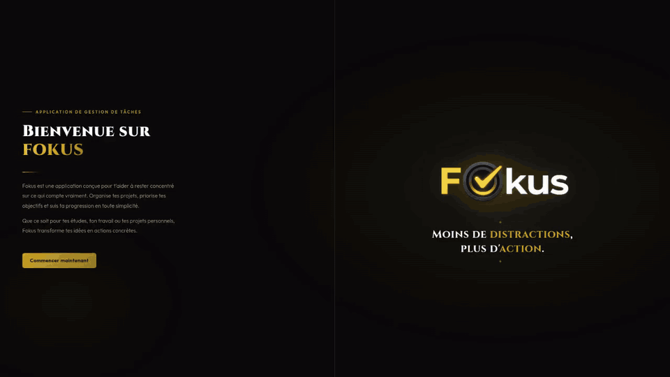

# 🎯 Fokus

[](https://github.com/RIZIWYX/fokus/actions/workflows/ci.yml)
[](https://fokus-riziwyx.vercel.app/)


[](LICENSE)



🌐 **Démo en ligne** : https://fokus-riziwyx.vercel.app/

Application web full-stack de gestion de tâches, conçue pour aider les étudiants
à organiser leur travail, visualiser leurs échéances et garder le focus.

Projet réalisé en binôme dans le cadre du cours **Langages web** — Licence 2 Informatique, Université de Rouen Normandie.

---

## ✨ Fonctionnalités

- 🔐 **Authentification sécurisée** — inscription, connexion, déconnexion, suppression de compte
- ✅ **Gestion complète des tâches** — création, modification, suppression, marquage urgent
- 📊 **Dashboard** — vue d'ensemble triée par statut (à faire, en cours, terminée) et tâches urgentes mises en avant
- 📅 **Agenda interactif** — calendrier mensuel avec navigation, jours cliquables et compteur de tâches par date
- 📈 **Statistiques personnelles** — suivi de la progression et de l'activité
- 🔎 **Recherche en temps réel** — filtrage instantané des tâches pendant la frappe
- 🎨 **Interface soignée** — thème sombre avec accents dorés, responsive

---

## 🛠️ Stack technique

| Couche | Technologies |
|--------|--------------|
| **Front-end** | HTML5, CSS3, JavaScript (vanilla) |
| **Back-end** | PHP 8+ (PDO) |
| **Base de données** | MySQL |
| **Outils** | Git, GitHub, VS Code |

Aucun framework — tout est écrit à la main pour bien maîtriser les fondamentaux.

---

## 📁 Structure du projet

```
fokus/
├── html/              # Pages utilisateur
│   ├── dashboard.php
│   ├── agenda.php
│   ├── page_login.php
│   └── ...
├── php/               # Logique métier
│   ├── security.php   # Bibliothèque centrale de sécurité
│   ├── login/         # Authentification (login, register)
│   ├── add/           # Création de tâches
│   ├── delete/        # Suppression (tâches + compte)
│   └── session/       # Données de session et statistiques
├── js/                # Scripts client
│   ├── main.js        # Recherche, interactions
│   ├── calendar.js    # Composant calendrier réutilisable
│   └── edit.js        # Édition de tâches
├── css/               # Feuilles de style
├── BDD/
│   ├── bdd.php        # Connexion PDO centralisée
│   └── config.example.php # Modèle de configuration (identifiants)
├── docs/
│   ├── compte-rendu.pdf   # Compte rendu du projet
│   └── securite-csrf.md   # Analyse d'une faille CSRF corrigée
└── sql/
    └── script.sql     # Schéma et données initiales
```

---

## 🔒 Sécurité

La sécurité a été un fil rouge du projet. La bibliothèque `php/security.php` centralise toutes les protections.

- **Mots de passe** hashés avec `password_hash()` (bcrypt) — jamais stockés en clair
- **Protection CSRF** sur tous les formulaires **et sur les actions sensibles** (suppressions, bascule « urgent »), déclenchées en POST avec jeton vérifié — jamais en GET
- **Requêtes préparées** (PDO) sur tous les accès à la base, contre les injections SQL
- **Validation stricte** de toutes les entrées utilisateur (longueur, format, type, listes fermées)
- **Protection contre les open redirects** — vérification du host du referer avant redirection
- **Vérification de la méthode HTTP** (POST imposé sur les actions sensibles)
- **Gestion centralisée des erreurs PDO** — détails dans les logs serveur, message générique côté utilisateur
- **Contrôle de session** — vérification systématique de l'existence du compte en BDD

---

## 🚀 Installation

### Prérequis

- PHP 8.0 ou supérieur
- MySQL / MariaDB
- Un serveur web (Apache)

### Étapes

1. **Cloner le dépôt**
   ```bash
   git clone https://github.com/RIZIWYX/fokus.git
   cd fokus
   ```

2. **Créer la base de données**
   ```bash
   mysql -u root -p < sql/script.sql
   ```

3. **Configurer la connexion**

   ```bash
   cp BDD/config.example.php BDD/config.php
   ```
   Puis renseigner dans `BDD/config.php` les identifiants MySQL (hôte, base, utilisateur, mot de passe). Ce fichier n'est pas versionné.

4. **Lancer le serveur**
   ```bash
   php -S localhost:8000
   ```

5. **Accéder à l'application**

   Ouvrir [http://localhost:8000/html/page_de_garde.php](http://localhost:8000/html/page_de_garde.php) dans le navigateur.

---

## 🎮 Utilisation

1. **Créer un compte** sur la page d'inscription (mot de passe d'au moins 8 caractères avec minuscule, majuscule et chiffre)
2. **Se connecter** depuis la page de login
3. **Ajouter des tâches** depuis le dashboard — titre, description, échéance, statut, urgence
4. **Consulter l'agenda** pour la vue calendrier
5. **Suivre l'avancement** via les statistiques

---

> 📄 Détail d'une faille CSRF identifiée et corrigée : voir [docs/securite-csrf.md](docs/securite-csrf.md)

## 👥 Auteurs

Projet réalisé par **Rayane Graïne** et son binôme — L2 Informatique, Université de Rouen Normandie, 2025-2026.

---

## 📄 Licence

Distribué sous licence **MIT**, voir [LICENSE](LICENSE).
